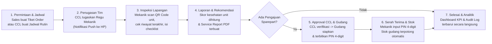

# SWORD: Service Workflow & Operational Resource Dashboard

**Sistem Informasi Manajemen Servis, Inspeksi Armada, & Logistik Suku Cadang Terpadu (Web & Mobile Android)**  
**Studi Kasus:** Operasional Pemeliharaan Armada Forklift & Baterai Traksi (PT United Multilift Perkasa)

---

## 1. Tentang Proyek

**SWORD** adalah platform operasional terintegrasi berbasis Web dan Mobile Android yang dirancang untuk mendigitalisasi seluruh alur pemeliharaan armada alat berat (forklift dan baterai traksi). Sistem ini menghubungkan tim sales, pemimpin divisi servis (*Customer Care Leader*), staf gudang (*Technical & Inventory*), tim manajemen eksekutif, serta mekanik lapangan ke dalam satu alur kerja yang terpantau secara langsung.

Sebelum sistem ini dibangun, pelaporan inspeksi di lapangan, penjadwalan teknisi, permintaan suku cadang, dan pencatatan stok gudang berjalan secara terpisah menggunakan formulir manual. SWORD menggantikan proses tersebut dengan formulir inspeksi digital berbasis QR Code, perhitungan skor kesehatan unit otomatis, persetujuan berjenjang, serta sinkronisasi stok gudang secara otomatis.

---

## 2. Alur Kerja Sistem (*End-to-End Flow*)

### Ringkasan Alur Operasional

1. **Inisiasi Pekerjaan:** Pekerjaan dapat berasal dari keluhan pelanggan yang dibuat tim Sales (*Tiket Order*), jadwal pemeliharaan rutin dari *Customer Care Leader* (CCL), maupun inspeksi mendadak/tambahan di lapangan.
2. **Penugasan Berbasis Tim:** CCL menugaskan regu mekanik (Leader dan anggota) untuk menangani unit tertentu. Seluruh anggota tim langsung menerima notifikasi push pada aplikasi Android mereka.
3. **Inspeksi Mobile Berbasis QR Code:** Di lokasi pelanggan, mekanik memindai QR Code pada unit forklift atau baterai, meninjau riwayat *Service Report* terakhir, lalu mengisi formulir inspeksi digital (dilengkapi foto bukti kerusakan, koordinat lokasi GPS, dan *autosave draft* lokal maupun server).
4. **Penilaian Kesehatan Unit & Laporan Standar:** Sistem menghitung persentase kesehatan unit berdasarkan bobot skor item pemeriksaan dan menandai statusnya (`Healthy`, `Attention`, atau `Critical`), lalu menghasilkan dokumen *Service Report* standar A4 siap cetak/ekspor PDF.
5. **Pengadaan Suku Cadang & Verifikasi PIN Gudang:** Rekomendasi maupun pemakaian suku cadang dari mekanik melewati verifikasi CCL terlebih dahulu sebelum diproses tim gudang. Saat barang siap diambil, gudang menerbitkan PIN 4 digit yang wajib dimasukkan mekanik pada aplikasi saat serah terima, sekaligus memotong stok katalog gudang secara otomatis.
6. **Pengawasan Eksekutif:** Direktur dan General Manager memantau KPI armada, ketersediaan tim mekanik, peringatan temuan kritis, menyetujui permohonan pembatalan/revisi tiket, dan meninjau *Audit Log* dari Dashboard Web.

---

## 3. Fitur Utama

### A. Portal Web Manajemen (7 Peran Pengguna / RBAC)
* **Dashboard Eksekutif:** Ringkasan KPI armada, grafik tren inspeksi dan kesehatan unit, komposisi sumber tugas, status kesiapan tim mekanik, serta daftar peringatan temuan kritis (*Critical Alerts*).
* **Manajemen Pelanggan, Aset, & QR Code:** Pengelolaan data pelanggan serta unit Forklift dan Baterai, lengkap dengan fitur impor/ekspor Excel massal dan generator cetak label QR Code.
* **Tiket Order & Persetujuan Pembatalan GM:** Pengelolaan keluhan pelanggan dan inspeksi mendadak dengan alur persetujuan General Manager apabila ada pengajuan revisi ke *draft* atau pembatalan permanen.
* **Manajemen Tim & Penjadwalan Inspeksi:** Pengaturan komposisi regu mekanik, pemantauan beban kerja tim, serta penjadwalan rutin satuan maupun massal via template Excel.
* **Pengadaan Sparepart & Inventaris Gudang:** Alur persetujuan berjenjang (`Mekanik -> CCL -> Gudang`), pembuatan PIN serah terima 4 digit, pemotongan dan pengembalian stok otomatis yang tercatat di log mutasi gudang, serta pemantauan stok menipis/habis.
* **Laporan Service & Cetak PDF A4:** Tampilan rekap seluruh laporan inspeksi dengan template cetak A4 standar perusahaan dan ekspor Excel.
* **Pengaturan Template & Audit Log:** Kustomisasi kategori dan item *checklist* inspeksi secara dinamis serta pencatatan rekam jejak aktivitas seluruh pengguna.

### B. Aplikasi Mobile Android Mekanik
* **Pemindai QR Code Unit & Input Manual:** Akses cepat identitas unit dan *Service Report* inspeksi terakhir langsung setelah memindai QR Code di lapangan.
* **Formulir Inspeksi Digital & Diagnostik Baterai:** Pengisian *checklist* forklift (skala 1 sampai 3 dengan unggah foto temuan) serta formulir servis baterai 40 sel.
* **Autosave Draft Dua Lapis:** Penyimpanan draf otomatis di perangkat (*local storage*) dan server untuk mencegah kehilangan data saat sinyal lapangan tidak stabil.
* **Riwayat Inspeksi & Ekspor PDF:** Akses dokumen laporan yang telah diselesaikan langsung dari ponsel untuk dibagikan dalam format PDF.
* **Notifikasi Push Real-Time & Pembaruan OTA:** Pemberitahuan instan tugas baru dan status suku cadang, serta dukungan pembaruan aplikasi *Over-The-Air* tanpa instalasi ulang APK.

---

## 4. Tech Stack

| Lapisan | Teknologi yang Digunakan |
| :--- | :--- |
| **Web Frontend** | React 19, TypeScript, Vite, Tailwind CSS, React Router v7, Recharts, QRCode.react, Axios |
| **Mobile App (Android)** | React Native, Expo SDK 57, React Navigation, Expo Camera, Location, Notifications (FCM), Print & Sharing, AsyncStorage, Expo Updates (OTA) |
| **Backend API** | Node.js, TypeScript, Hono, `@hono/node-server`, ExcelJS, `web-push` (VAPID) |
| **Database** | PostgreSQL (relational schema + JSONB, transaction-safe row locking) |
| **Autentikasi & Keamanan** | JWT (HS256), Rolling Refresh Token Session (90 hari), `bcryptjs`, RBAC 7 peran, *Anti-Double-Submit* middleware, HMAC signed media URLs |
| **Shared Package** | Monorepo npm workspaces (`@digital-inspect/shared`) untuk berbagi tipe data dan kalkulator skor kesehatan |
| **CI/CD & Infrastruktur** | GitHub Actions (otomatisasi build Android Release APK via Gradle), Nginx reverse proxy, Docker Compose (PostgreSQL dev), Self-hosted Expo OTA |

---

## 5. Cuplikan Antarmuka Sistem (*Screenshots*)

### A. Portal Web Manajemen (`apps/web`)

#### 1. Beranda Publik, Login, & Profil Pengguna

*Beranda publik portal web dengan tombol masuk portal dan unduhan APK Android.*

*Halaman login autentikasi akun perusahaan.*

*Pengaturan profil akun, unggah foto profil, dan ubah kata sandi.*

#### 2. Dashboard Eksekutif & Notifikasi Real-Time

*Ringkasan armada, jumlah inspeksi selesai, komposisi sumber pekerjaan, dan kontrol operasional.*

*Tabel operasional tiket, sparepart, dan grafik aktivitas inspeksi serta status kesehatan aset.*

*Panel Active Alerts dan status ketersediaan tim mekanik secara langsung.*

*Panel notifikasi real-time pada bilah atas lengkap dengan kontrol suara dan tautan langsung ke modul.*

#### 3. Tiket Order, Pengadaan Sparepart, & Inventaris Gudang

*Pengelolaan Tiket Order keluhan service dan inspeksi dadakan.*

*Alur persetujuan sparepart (Approval CCL hingga Validasi PIN Gudang 4-digit).*

*Katalog inventaris suku cadang, status stok aman/menipis/habis, serta lokasi rak gudang.*

*Riwayat mutasi stok otomatis (keluar saat serah terima/tiket selesai dan masuk kembali saat pembatalan).*

#### 4. Pelanggan, Aset (Forklift & Baterai), & QR Code

*Data pelanggan beserta fitur template dan impor massal Excel.*

*Daftar armada forklift lengkap dengan Serial Number, pelanggan, dan skor kesehatan.*

*Tab manajemen unit baterai traksi.*

*Generator dan pratinjau cetak label QR Code untuk ditempel pada setiap unit aset.*

#### 5. Tim Mekanik, Penjadwalan, Laporan, Audit, & Pengaturan

*Pengelolaan komposisi tim mekanik serta penjadwalan inspeksi satuan maupun Excel.*

*Rekap laporan hasil inspeksi lengkap dengan ekspor Excel dan bilah gulir atas.*

*Rincian Service Report Forklift lengkap dengan metadata tim, koordinat GPS, skor kesehatan, dan cetak PDF A4.*

*Pengelolaan akun pengguna dan pembagian peran akses (RBAC).*

*Catatan rekam jejak seluruh aktivitas pengguna beserta ekspor CSV.*

*Pengaturan dinamis kategori dan item pemeriksaan checklist Forklift.*

*Pratinjau standar formulir Battery Service Report.*

*Pengaturan ambang batas kesehatan unit (`Healthy`, `Attention`, `Critical`) dan rumus kalkulasi.*

---

### B. Aplikasi Mobile Android Mekanik (`apps/app`)

*Layar login aplikasi mobile mekanik.*

*Beranda mekanik dengan tombol Scan QR Code Unit, ringkasan tugas harian, dan daftar jadwal aktif.*

*Daftar tugas inspeksi yang telah diselesaikan pada tab Selesai.*

*Modal input kode aset manual sebagai alternatif apabila QR fisik sulit dipindai kamera.*

*Panel notifikasi operasional pada aplikasi mobile.*

*Layar pemindai QR Code kamera.*

*Layar Detail Aset setelah pencarian/pemindaian unit.*

*Riwayat dokumen inspeksi mekanik dengan filter tipe unit dan rentang waktu.*

*Detail laporan Service Report pada perangkat mobile lengkap dengan fitur Export PDF.*

*Layar profil akun mekanik untuk ubah nama, kata sandi, dan keluar dari sesi.*

---

> **Catatan Portofolio:** Untuk dokumentasi teknis mendalam (skema 23 tabel basis data, daftar lengkap endpoint API, dan rincian validasi), lihat [Deskripsi-Sistem.md](Deskripsi-Sistem.md). Apabila portofolio ini akan dipublikasikan secara terbuka di luar tim internal, pertimbangkan untuk menyensor nama perusahaan pelanggan dan nomor seri unit yang tampak pada sebagian *screenshot*.
